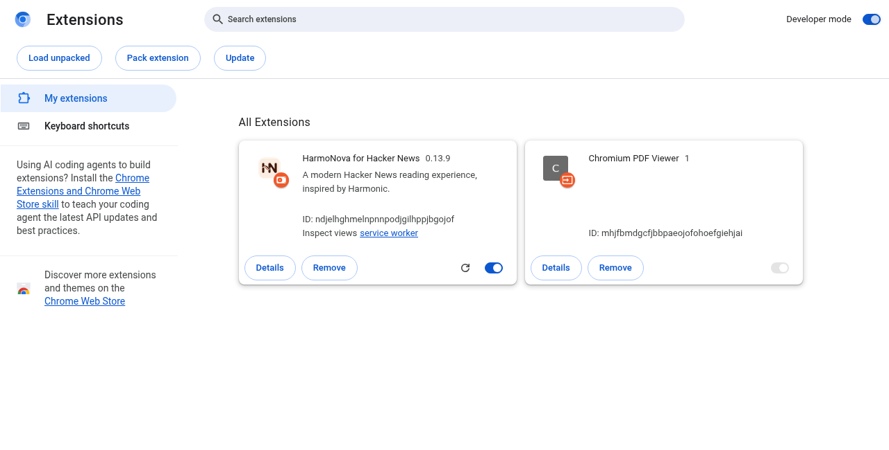

<p align="center"></p>

# HarmoNova for Hacker News — Chrome Browser Extension

**A better place to read Hacker News on your browser.**

HarmoNova for Hacker News is a Chrome extension that gives [Hacker News](https://news.ycombinator.com/) a cleaner, more enjoyable desktop interface. Read stories, follow discussions, search Hacker News, and use your HN account without leaving the website.

**Inspired by [Harmonic for Hacker News](https://github.com/SimonHalvdansson/Harmonic-HN) by Simon Halvdansson.** This is an independent project, not affiliated with or endorsed by the original developer.


## Install in Chrome

**No coding or building required.** Just download the extension, extract it, and tell Chrome where the folder is.

1. **Download:** Go to [**Releases**](https://github.com/chaosmanage/harmonova/releases/latest) and download the ZIP named `harmonova-<version>.zip` under **Assets**.
2. **Unzip it:** Extract the downloaded ZIP. Open the extracted folder; inside you'll find a folder named **`harmonova`**. Keep it somewhere permanent, like Documents.
3. **Open Chrome extensions:** Type **`chrome://extensions`** into Chrome's address bar.
4. **Turn on Developer mode** using the switch in the top-right corner, then click **Load unpacked**.
5. **Choose the folder:** Select the inner **`harmonova`** folder — the one that directly contains the file **`manifest.json`**. Don't select the ZIP itself.
6. **You're done:** Open [news.ycombinator.com](https://news.ycombinator.com/), or refresh it if it was already open.



### Prefer downloading the source or using Git?

That works too. On the [repository page](https://github.com/chaosmanage/harmonova), choose **Code → Download ZIP** and extract it, or clone it:

```bash
git clone https://github.com/chaosmanage/harmonova.git
```

Then follow **steps 3–6 above**, selecting the downloaded or cloned **repository folder** (the folder with `manifest.json`). **You still don't need to build anything.**

To update an unpacked installation, keep the same folder location, replace its contents (or run `git pull`), click **Reload** on `chrome://extensions`, and refresh Hacker News. [Having trouble?](docs/TROUBLESHOOTING.md)

## Why I made this

I really enjoy using [**Harmonic for Hacker News on Android**](https://github.com/SimonHalvdansson/Harmonic-HN). Compared with Harmonic, the regular Hacker News website never felt particularly appealing or intuitive to me. I wanted to bring that same reading experience to my computer.

I even tried running the Android app in an emulator. It worked as an experiment, but it wasn't how I wanted to use Hacker News every day. A **Chrome extension** turned out to be the better solution: open Hacker News in a normal browser tab, and get the Harmonic-inspired interface right there.

**A huge thank-you to [Simon Halvdansson](https://github.com/SimonHalvdansson/Harmonic-HN) for the original Harmonic Android app.** Its design, thoughtful approach to reading, and open-source code are the reason this project exists. I've taken a lot of inspiration from it, including the story cards, colors, typography, and comment layout. This is an independent browser adaptation, not an official Harmonic desktop app.

If you've never used Harmonic on Android, that's fine. All you need to know is that this extension makes Hacker News more comfortable to read on a desktop.

## What can it do?

- **Read side by side.** Stories stay on the left while the discussion opens on the right.
- **Browse more feeds.** Top, New, Best, Ask HN, Show HN, Jobs, and more.
- **Follow conversations.** Color-coded reply depths, collapsible threads, comment search, and sorting.
- **Search all of Hacker News.** Find stories or comments and filter by date, author, and more.
- **Make it yours.** Dark themes, fonts, story previews, comment styles, and other settings.
- **Use your HN account.** Vote, reply, submit stories, and manage favorites, using Hacker News's own login.
- **Summarize with AI (optional).** Use your own OpenRouter key to summarize an article or its HN discussion.

### A closer look

| Feeds | Search Hacker News |
| --- | --- |
|  |  |

| Appearance | Story settings |
| --- | --- |
|  |  |

[Explore the full feature guide, including more screenshots →](docs/FEATURES.md)

## AI summaries: articles or discussions

Sometimes I want the main points of an article before reading it. Other times the **Hacker News comments** are the interesting part. HarmoNova has a separate button for each:

- **Article** reads the linked page and summarizes its content.
- **Discussion** summarizes the public Hacker News conversation instead.

Both use [OpenRouter](https://openrouter.ai/) and are optional. Add your own API key in **Settings → AI** and select a model. Nothing is summarized unless you request it (unless you choose to enable automatic summaries in Settings). The text being summarized is sent to OpenRouter; not every article site allows automatic reading.


*AI interface demonstration. The example summary text is mocked, not a summary of the article shown.*

## A couple of things to know

You don't need to sign in just to read. For voting, replying, or posting, HarmoNova uses your Hacker News session; login happens on HN itself. Editing or deleting **existing** comments currently opens HN's original edit/delete page after asking for confirmation.

You can always open **original Hacker News** from the menu or turn off HarmoNova from the extension icon without uninstalling it. The extension runs on `news.ycombinator.com`; it has no project-run server or analytics. [Read more about privacy and permissions.](docs/PRIVACY.md)

## More information

[Full feature guide](docs/FEATURES.md) · [Installation help](docs/TROUBLESHOOTING.md) · [Architecture](docs/ARCHITECTURE.md) · [Contributing and development](docs/DEVELOPMENT.md) · [Changelog](CHANGELOG.md)

## Credits and license

**Credit:** HarmoNova was inspired by [Harmonic for Hacker News](https://github.com/SimonHalvdansson/Harmonic-HN), created by Simon Halvdansson. Thanks to Simon for publishing the original Android project under Apache License 2.0 and for the design inspiration.

HarmoNova's icon and wordmark are independently designed, and the extension now uses browser/system fonts rather than the original project's rounded font. See [branding details](icons/README.md).

HarmoNova is an independent project and is **not affiliated with or endorsed by** the Harmonic developer, Hacker News, or Y Combinator. This extension is licensed under [Apache License 2.0](LICENSE).
