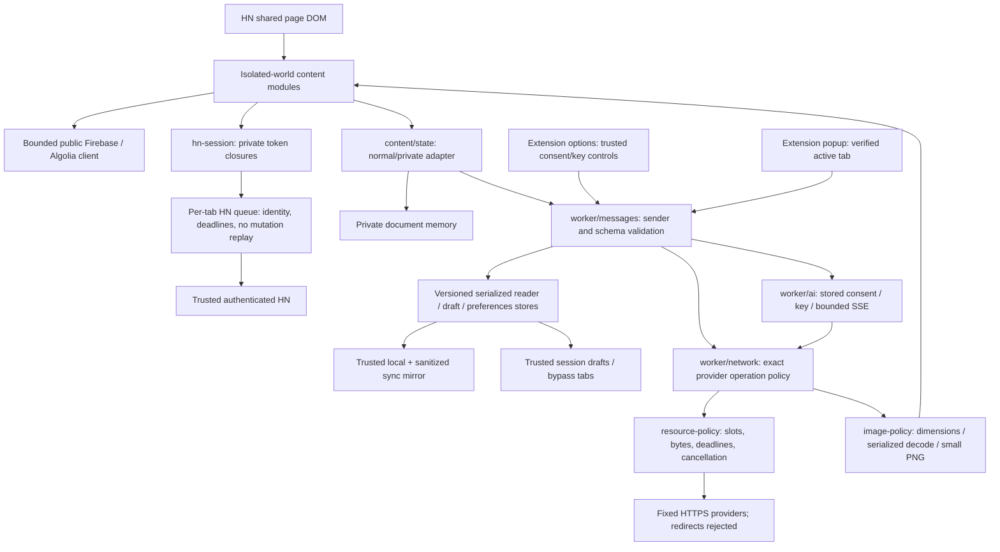

# How HarmoNova works

[← README](../README.md) · [Development](DEVELOPMENT.md) · [Privacy](PRIVACY.md)

HarmoNova is a classic-script Manifest V3 extension with no runtime npm dependencies, build framework, or project backend. The manifest orders isolated-world module definitions before `content.js`; `background.js` loads worker definitions with `importScripts()`. Entry points compose explicit dependencies and restricted field facades. Runtime modules are not web-accessible; only the two bundled font files are exposed to HN.

## Ownership

| Modules | Responsibility |
| --- | --- |
| `message-boundary`, `settings-schema`, `ai-policy`, `url-policy`, `provider-policy` | Pure caller/data/policy validation; no caller-supplied authority. |
| `worker/storage`, `reader-store`, `preferences-store` | Trusted storage access, one-time migrations, serialized patches, draft revisions/generations, best-effort revision broadcasts. A stalled tab receiver cannot hold the storage lock. |
| `worker/messages` | Synchronous listener registration, fail-closed initialization, exact sender/field dispatch and per-document preview cancellation. |
| `worker/network`, `resource-policy`, `image-policy` | Exact provider operations, credential-free redirect rejection, bounded streams, shared consumers, bounded caches and raster sanitization. |
| `worker/ai` | Stored key/consent, verified story URL, one active paid request per tab, stream framing/output bounds, explicit retry consent and port cleanup. |
| `content/state`, `incognito-state` | Worker-backed normal state and separate per-document private memory. |
| `content/feed`, `reader`, `comments`, `search-ui`, `previews` | Reader rendering, bounded lazy previews, generation/lifecycle ownership and DOM cleanup. |
| `content/composer`, `actions`, `summary-ui` | Trusted final actions, captured composer identity/text, honest outcomes and one-use summary intent. |
| `content/settings`, `toolbar`, `dom`, `links`, `sanitize` | Cosmetic controls, narrow exports/imports, owned DOM helpers, safe anchors and bounded inert HTML copying. |
| `hn-session`, `hn-queue` | Private HN tokens/forms, explicit read/mutation classification, account checks, queue disposal and bounded authenticated HTML. |
| `hn-search`, `lifecycle` | Bounded public queries/tree validation, real inert DOM highlight parser, scoped abort/disposal. |

HN is a separately trusted authenticated client. Native HN redirects remain supported with final-origin verification. External provider requests use `redirect:error`, omit credentials/referrers and reject arbitrary origins. Required host permissions are exact origins, and pure URL validation does not claim to enforce DNS destinations.

## Budgets and lifetime

External transport has six active slots, two per origin, and 100 queued jobs. A slot lasts through headers and body consumption. Metadata/rich text use 6-second deadlines; image input is 2 MiB, 4096 pixels per edge and 8,388,608 total pixels. Re-encoded PNG output is at most 256 KiB with a 1024-pixel longest edge. Metadata caches are limited to 200 entries/4 MiB; image caches to 40 entries/8 MiB. Failed cache entries expire sooner. AI streams are capped at 2 MiB/120 seconds, 10,000 events, 128 KiB per event and 64 KiB output characters.

HN HTML and public JSON are capped at 4 MiB/15 seconds. Public trees have 64-level, 5,000-element-array and 50,000-value limits. The HN queue has 50 waiting jobs, a 30-second wait deadline and 15-second active deadline including 750 ms spacing, per tab. Mutation ambiguity is never converted into an automatic replay.

Feed, thread, composer and search scopes abort obsolete consumers; generation guards reject late results. Preview card removal prunes consumers/observers and queues. Private state is destroyed with its document. Worker storage/consent initialize before sensitive dispatch; unavailable or newer unknown schemas fail closed. Source and release use the same offline browser entry points and actual module loaders, checked against an explicit package allowlist.
