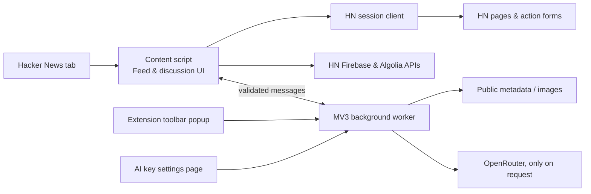

# How Harmonic works

[← Back to README](../README.md) · [Development](DEVELOPMENT.md) · [Privacy & security](PRIVACY.md)

Harmonic is a **Manifest V3 browser extension**, not a separate website or a port of the Android app. Open HN as usual and the extension replaces the reading interface. Stories and discussion content still come from HN-related APIs; signing in still happens on Hacker News. There is no project-owned backend or build step.

The content script draws the UI and an extension service worker handles cross-origin requests. That separation keeps optional OpenRouter credentials out of the Hacker News page.

## At a glance

The Mermaid diagram renders on GitHub. The important boundary is between the **HN page reader** and the **extension-owned background worker**. A web page shouldn't be able to retrieve stored credentials or make the worker send arbitrary privileged requests.

## Where the code lives

| File | Responsibility |
| --- | --- |
| `manifest.json` | Chrome permissions, HN-only content-script match, background worker, popup, and options page. |
| `content.js` | Rendering and interaction: story feeds, thread reader, panels, settings, menus, and summary display. |
| `styles.css` | Desktop layout, cards, comment depth, reader themes, typography, and overlays. |
| `hn-session.js` | HN login/session detection, bounded form parsing, voting, replies, submissions, account actions, and a serialized HN request queue. |
| `hn-search.js` | Algolia site-wide search, query validation, pagination, and safe result highlights. |
| `background.js` | Metadata fetching, previews, font integrity, URL-checked fetches, storage, original-HN tab mode, and streaming AI requests. |
| `url-policy.js` | Validates external HTTP(S) targets and redirects to avoid unsafe destinations. |
| `popup.*` | Extension icon popup for toggling Harmonic, opening settings, and original-HN tabs. |
| `ai-settings.*` | Extension-owned OpenRouter API-key editor, isolated from the Hacker News page. |
| `icons/` | Four Chrome icon sizes and their exact attribution record. |
| `tests/` | Node and Chromium regression tests, including mocked HN forms and sanitized fixtures. |
| `scripts/` | Packaging and test-fixture tooling. |

There are no npm runtime dependencies required to **use** the unpacked source. `playwright-core` is a development dependency for the Chromium tests.

## From page load to reader

1. A browser opens `https://news.ycombinator.com/news` or another HN URL.
2. Chrome injects `url-policy.js`, `hn-session.js`, `hn-search.js`, `content.js`, and `styles.css` at `document_start`.
3. Harmonic checks the enabled preference and whether the tab was explicitly marked for original HN. If either check says not to replace the page, it leaves the native site visible.
4. Otherwise the content script builds the feed, queries HN's Firebase API for public stories, and loads discussion trees from Algolia. Original HN pages remain authoritative for account actions.
5. Optional metadata and image fetches go through the background worker, which applies URL rules before touching external hosts. Preview results are short-lived and cached.
6. UI state remains in the tab while non-secret preferences and optional account-related local reader state persist in their appropriate Chrome storage areas.

The feed and discussion pane have separate scrolling behavior. An offsite article link opens a normal browser tab; the extension's content script doesn't follow it into that site.

## Account requests and state

The session client obtains action links and hidden form values from HN itself rather than making up authentication tokens. It uses a serial queue for HN requests, validates the active account, and avoids accidentally repeating operations that could duplicate a post or reply. HN can reject an action or demand validation; the UI must not announce success without confirmation.

For new comments and story submissions, the extension performs follow-up checks where needed while preserving drafts if the result is ambiguous. **Existing-comment edit/delete** currently bypasses this machinery: the user sees an explicit notice before being sent to HN's original edit or delete form.

The original-HN action creates a separate tab identified as a bypass tab in session storage *before* navigating to HN. This prevents the content script from immediately replacing that untouched site as it loads.

## AI request path

1. The user explicitly selects **Article** or **Discussion** in the thread header.
2. The worker obtains the selected public content. For articles it extracts readable text from the linked webpage; for discussions the source is public HN comments.
3. Article text is bounded, normalized, and sent to OpenRouter with the chosen prompt/model and the user's key. Generated tokens stream over a Chrome extension port into a summary card.
4. The user can stop the request. Summary text stays in the current page's memory rather than Chrome Sync.

The options page owns API-key entry and storage. The HN document does not receive the key. Font loading and external previews use validated credential-free worker fetches.

## Testing philosophy

HN's real HTML, session forms, and edge cases matter. The test suite uses sanitized captures and realistic synthetic logged-in fixtures so Chromium can assert the **actual outgoing request shape**, not just a mocked JavaScript handler. Security tests exercise message origins, URL rejection, and escaping. Tests that require real credentials are opt-in; never commit raw HN captures, credentials, or traces.

The detailed test commands, package format, and release checklist are in [Development](DEVELOPMENT.md).
