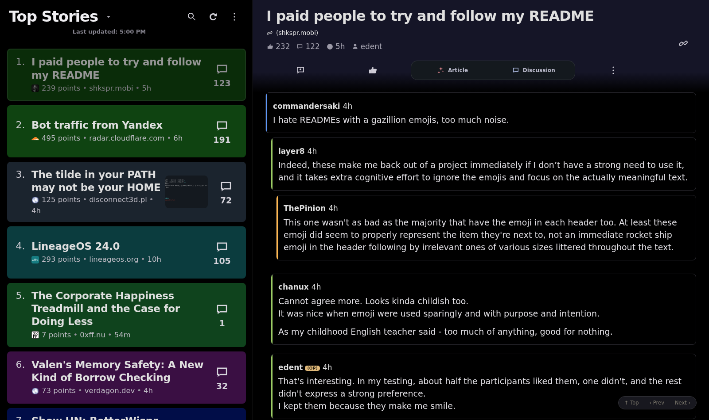
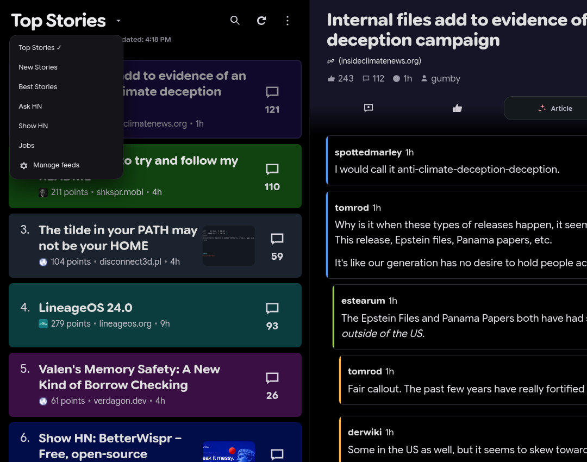
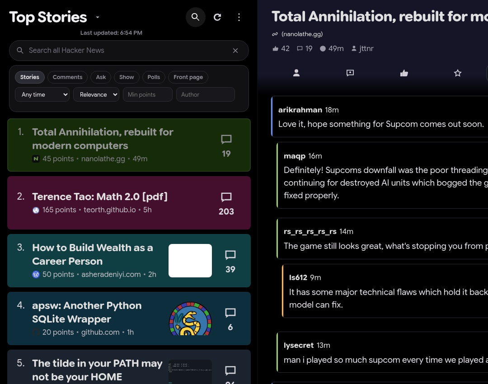
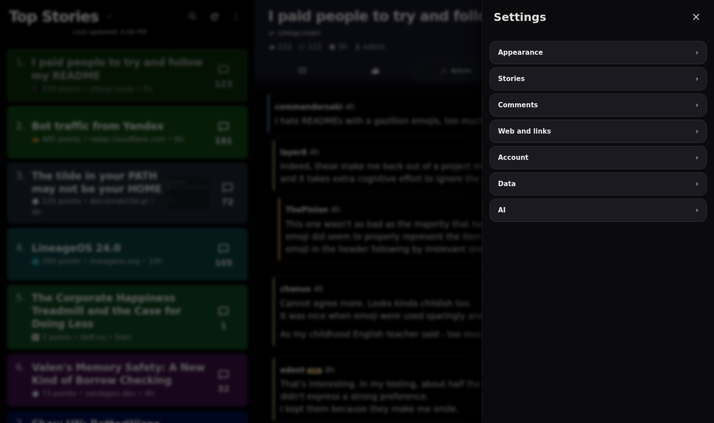
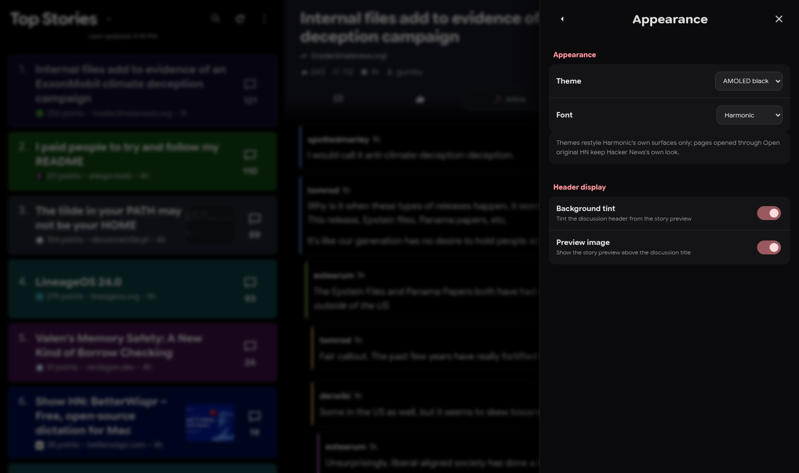
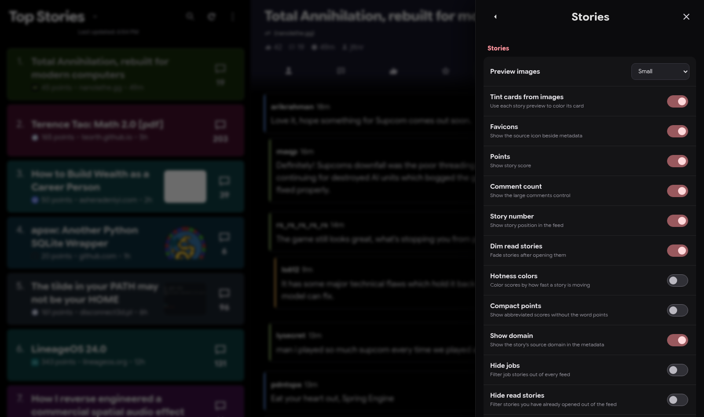
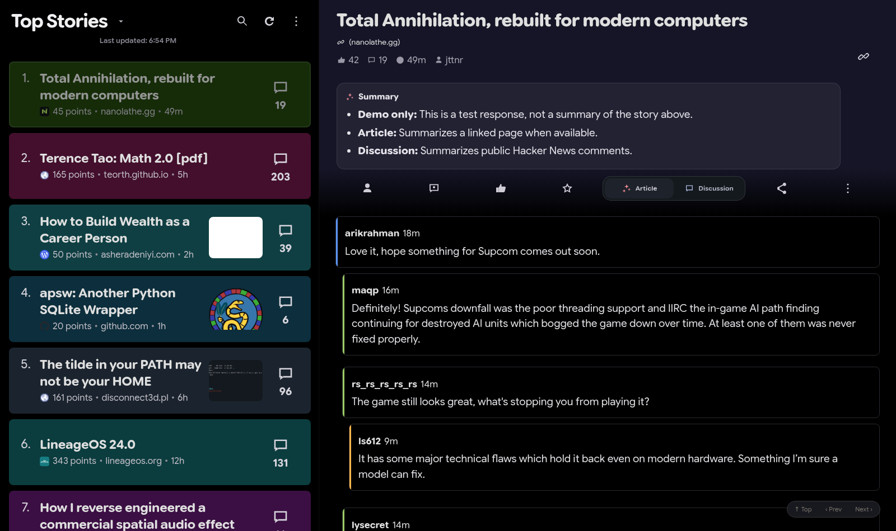

# Using HarmoNova

[← Back to README](../README.md) · [Installation help](TROUBLESHOOTING.md)

HarmoNova changes how you **read** Hacker News, not where the discussions live. Open [news.ycombinator.com](https://news.ycombinator.com/) with the extension enabled. There are two panes: stories on the left, the selected discussion on the right. Both scroll independently.

## The reading view

### Stories on the left

Choose a feed from the title menu: Top, New, Best, Ask HN, Show HN, Jobs, and additional HN collections such as Active Discussions, Best Comments, Launch HN, and past front pages. Use **Manage feeds** to hide or reorder the less-used ones.

Each story card can show its title, points, domain, age, reply count, favicon, and an optional preview image. Card tints help stories stand apart without turning the entire page into a grid of boxes. Story settings let you change density, preview sizing, points display, dimming for read stories, keyword/domain filters, and whether a card click opens the article or its comments.

Click the comment count to open the discussion in the right pane. Article links open in a normal browser tab; HarmoNova doesn't trap external links in its own reader.

### The discussion on the right

The header holds the story title, link, metadata, author, and the main actions: **Add reply**, **Upvote**, **Article summary**, **Discussion summary**, and **More**. Less-frequent actions, including bookmarks and favorites, belong in the More menu.

Underneath, comments form a tree. Colored depth rails make it easier to see who is answering whom. Click a branch to collapse it; expand it when you want the context back. There are also controls to collapse/expand all comments, search within the current thread, move between top-level comments, and change the comment sort order.

Other useful touches include an **OP** marker beside comments from the story author, optional author avatars, highlighting of newly arrived comments, and collapsible `[delayed]` placeholders.

## Search beyond the current feed

The search field has two distinct modes:

- **Loaded stories** filters what is already on your screen. This stays in the browser.
- **All of Hacker News** queries the public [Algolia HN Search](https://hn.algolia.com/) index. You can filter stories or comments by category, date, points, and author, and sort by relevance or time.

Search results open inside the same reader. For comment results, HarmoNova can take you to the relevant discussion and comment. Site-wide results come from Algolia's index, so an extremely recent comment may not be indexed immediately.

## Your Hacker News account

Reading needs no login. To interact as a user, sign in through **Hacker News's own login page** using the account entry in HarmoNova. HarmoNova doesn't ask for, read, or store your HN password.

When HN supplies the appropriate signed-in controls, you can upvote stories and comments, downvote eligible comments, reply to stories and comments, submit new stories, favorite, hide, and flag eligible items. A flag or destructive action asks for confirmation. Hide also offers an immediate undo. Account views include your threads, submissions, favorites, hidden, and upvoted lists, as well as public user profiles and their public activity.

### Replies, drafts, and limits

**Add reply** and the reply action on individual comments open the built-in composer. It includes a preview, character counter, and `Ctrl+Enter` to submit. Drafts are saved temporarily for the current browser session, keyed to the current account and comment, so closing and reopening a composer doesn't throw away what you typed. If Hacker News requires additional validation, HarmoNova preserves the draft and offers the original HN form.

**Editing or deleting an existing comment is not yet supported inside HarmoNova.** Choose Edit or Delete on one of your own comments, review the notice, and continue to the actual Hacker News form in a separate original-HN tab. Cancelling leaves the comment alone. HN's own anti-automation and rate-limit checks can also prevent other account actions; do not assume a failed confirmation means HN accepted the action.

## Make it your reader

Open **Settings** from HarmoNova's menu or the extension toolbar popup.

Settings are organized by **Appearance, Stories, Comments, Web and links, Account, Data, and AI**. You can choose an AMOLED-black, charcoal, or deep-navy color scheme; use Google Sans Flex Rounded by default or switch to System UI or Serif; adjust zoom and story display; change comment treatment; control preview images and favicons; and configure link behavior. In the Data section you can export or import bookmarks, read-story IDs, user tags, and blocked-user rules as a JSON file.

| Appearance | Story settings |
| --- | --- |
|  |  |

Tags and blocking are **private local reading preferences**, not HN account features. Tagging a username helps you recognize them later; blocking replaces their comments with an unblockable placeholder. Neither setting changes what other users see on Hacker News.

### Link extras

- **Rich link previews** add a small information panel for supported GitHub repositories, Wikipedia pages, and arXiv papers.
- **View on archive** opens the Wayback Machine when you want to look for an older copy of an article.
- **Nitter redirect** is opt-in. If enabled, Twitter/X links point to your configured Nitter instance instead.

You can turn these extras off in Settings. Not every external site provides metadata or accepts automated fetches.

## Optional AI summaries

The **Article** and **Discussion** buttons are separate for a reason: one summarizes a linked article, the other summarizes public conversation on HN. They are not interchangeable sources.

1. Open Settings → **AI** and configure an [OpenRouter](https://openrouter.ai/) API key through the extension's own settings page.
2. Choose a model (the initial default is `openrouter/free`). Availability and pricing are determined by OpenRouter, not this project.
3. Open a story and click **Article** or **Discussion**. The request runs only when you click.
4. You can stop a running summary or regenerate it. The summary appears in the current reader, not in a new service.

For an article summary, HarmoNova fetches and extracts readable article text. Some websites block this; you may then choose to summarize public HN discussion separately. For a discussion summary, the source is the public comments rather than the external article. **Extracted source text is sent to OpenRouter** along with the configured summary prompt. Generated summaries can be inaccurate, especially on ambiguous threads.

*Demonstration screenshot with a mocked OpenRouter response. The example text is not a real summary of the visible article.*

The AI key can be stored **in this Chrome profile** or **for this browser session only**. It isn't synced via Chrome Sync. See [Privacy & security](PRIVACY.md) for the precise data flow and storage trade-offs.

## Want the original site back?

You have two choices that do not require uninstalling anything:

- **Open original Hacker News** opens an untouched HN tab. Navigation inside that tab remains in original-HN mode.
- **Disable HarmoNova** in the extension toolbar popup or in-page menu turns off the HarmoNova layout. Switch **Enable HarmoNova** back on to restore it.

If something isn't displaying correctly, see [Troubleshooting](TROUBLESHOOTING.md). For implementation details, see [Architecture](ARCHITECTURE.md).

Security update: external previews require a saved preference in the extension
settings page and work only with supported GitHub, Wikipedia and arXiv links.
Other links show a placeholder and still open normally. AI requires fresh consent,
including after upgrading; saving a key alone does not enable it. Arbitrary article
extraction is unavailable; public HN discussion summaries remain supported.
